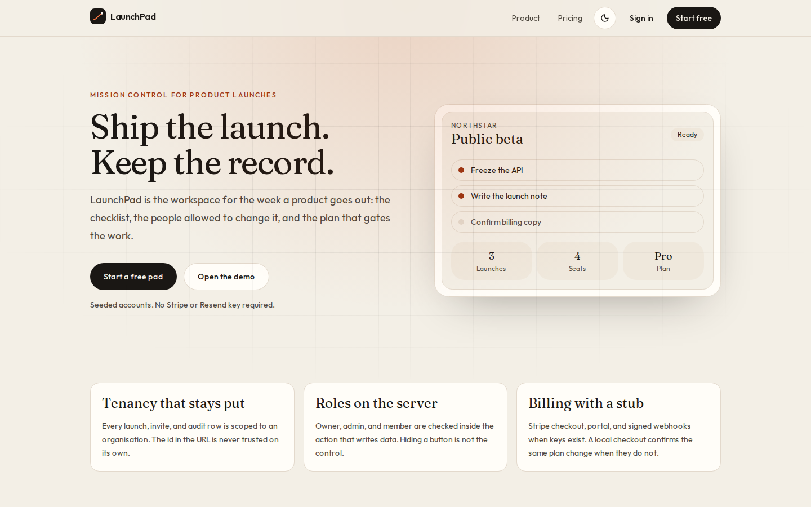
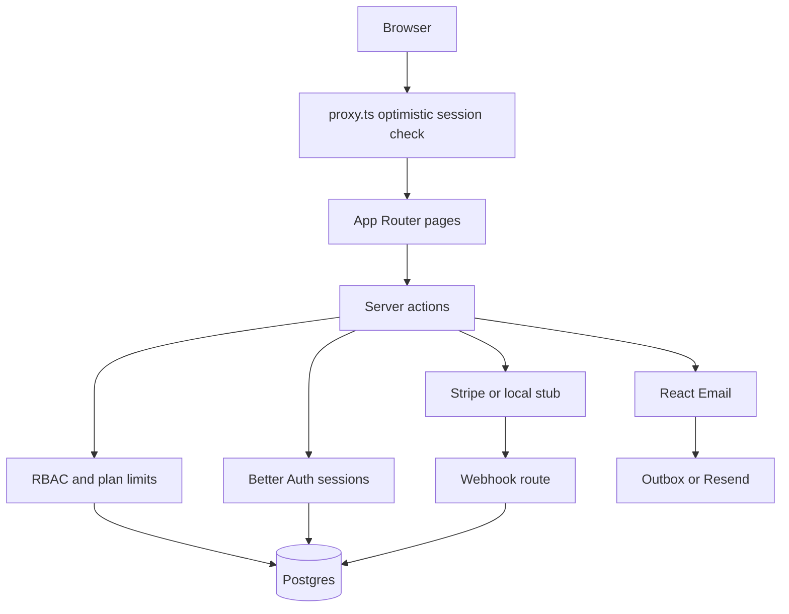
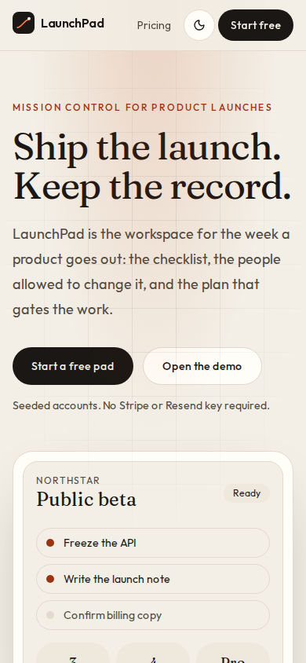
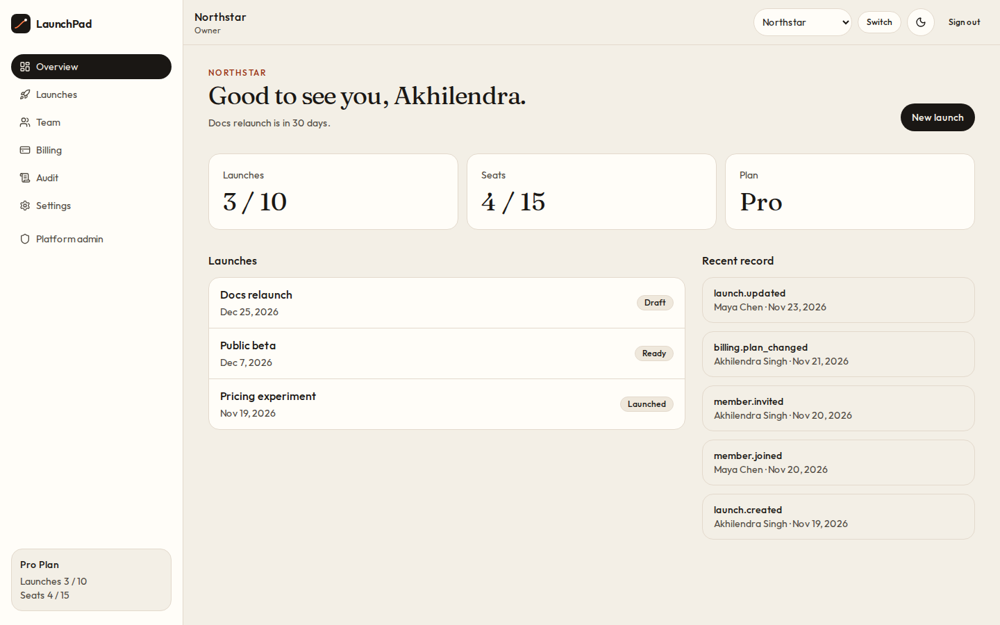

# LaunchPad



LaunchPad is a portfolio-grade SaaS starter for planning a product launch with a team. It is built by [Akhilendra Singh](https://github.com/AkhilSingh2) to show the pieces a production multi-tenant app actually has: sessions, organisations, roles enforced on the server, Stripe subscriptions with idempotent webhooks, an audit log, rate limits, and transactional email.

It runs locally with **no paid accounts**. Demo users are seeded. Stripe and Resend are real when you add keys, and stubbed when you do not.

## Features

- Email and password auth, plus GitHub and Google when those keys exist
- Organisations with invites and owner / admin / member roles
- Server-side RBAC on every mutation, not only in the UI
- Launches and checklists gated by the organisation plan
- Stripe Checkout, Customer Portal, and signed webhooks, with a local checkout stub
- Audit log, platform admin, settings, and rate limits on sign-in and invites
- React Email templates, a dev preview, and an outbox when Resend is unset
- Light and dark theme, responsive layout, keyboard-reachable controls

## Architecture



The proxy only checks that a session cookie exists. The server action loads the session, loads the membership, and checks the role before it writes. A launch id in the URL is loaded with the organisation id from that membership, so one tenant cannot read another tenant's row.

## Stack

Next.js App Router, TypeScript, Postgres, Drizzle, Better Auth, Tailwind CSS, shadcn-style UI primitives, Zod, Stripe, Resend, React Email, Vitest, Playwright.

## Run locally

Requirements: Node 22 and either Docker or a local Postgres 16.

```bash
docker compose up -d
cp .env.example .env
pnpm install
pnpm db:setup
pnpm dev
```

Open [http://localhost:3000](http://localhost:3000). The demo password for every seeded account is `launchpad`.

| Email | Role on Northstar | Also |
| --- | --- | --- |
| akhil@launchpad.dev | Owner | Platform admin |
| maya@launchpad.dev | Admin | |
| jordan@launchpad.dev | Member | Cannot read the audit log |

`pnpm db:setup` migrates and seeds. Northstar is already on the Pro plan via the local stub, with three launches and a pending invite to `guest@launchpad.dev`.

Without `STRIPE_SECRET_KEY`, **Billing → Try Pro locally** opens an in-app checkout. Confirming it writes the plan, an idempotency row, an audit entry, and a billing email. Without `RESEND_API_KEY`, mail is stored in the outbox at [/dev/emails](http://localhost:3000/dev/emails).

```bash
pnpm lint
pnpm typecheck
pnpm test
pnpm build
pnpm test:e2e
```

## Deploy

The app is ready for Vercel plus any hosted Postgres (Neon, Supabase, or RDS).

1. Create a Postgres database and set `DATABASE_URL`.
2. Set `BETTER_AUTH_SECRET` to a long random value and `BETTER_AUTH_URL` to the public origin. The placeholder in `.env.example` is refused when `VERCEL=1`.
3. Set `REQUIRE_AUTH_SECRET=true` on any other host if you want that same refusal.
4. Run `pnpm db:migrate` against that database. Do not run the demo seed in production.
5. Add Stripe test or live keys and price ids when you want real checkout. Point the webhook at `/api/stripe/webhook`.
6. Add `RESEND_API_KEY` and a verified `EMAIL_FROM`. Leave `EMAIL_PREVIEW` unset so `/dev/emails` stays closed.
7. Add GitHub or Google OAuth credentials if you want those buttons enabled.

No secrets belong in git. `.env.example` only contains local placeholders.

## What this demonstrates

- Session cookies and a database session, with optimistic routing in `src/proxy.ts` and the real check in server actions
- Multi-tenancy: the active organisation is a cookie, and every query is constrained by a membership row
- RBAC that an interviewer can read in `src/lib/rbac.ts` and see applied in `src/server`
- Plan gating before insert, not after
- Webhook idempotency: the Stripe event id is inserted first, and a duplicate delivery does not apply twice
- A billing stub that exercises the same write path as the webhook
- Rate limiting without Redis, and a note that production should move that store to Redis or Upstash
- Transactional email that still works on a laptop

The study guide is [docs/LEARNING.md](docs/LEARNING.md). It walks the code paths and has exercises aimed at an interview.

## Screenshots

| Landing | Workspace |
| --- | --- |
|  |  |
